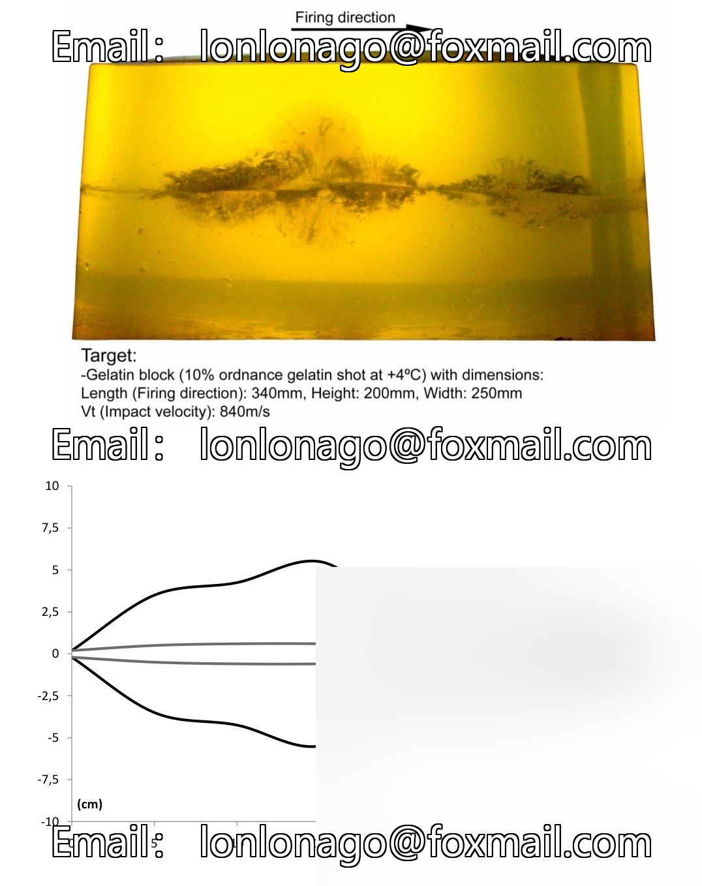
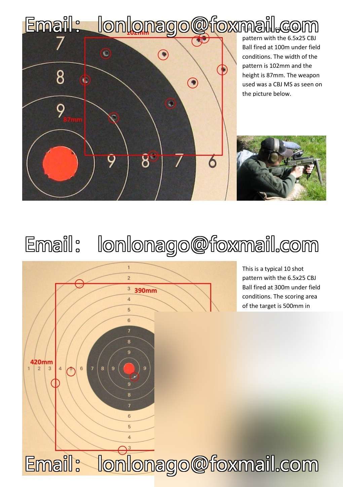
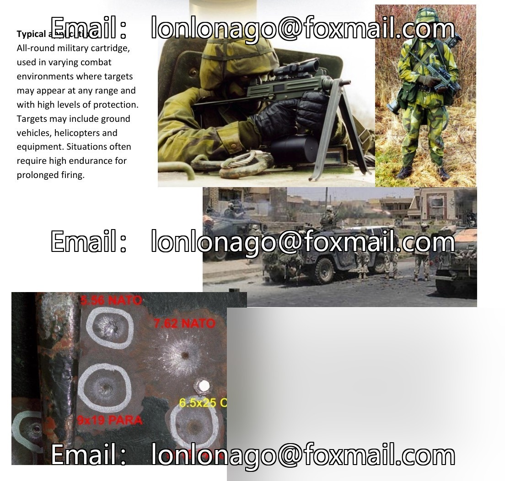
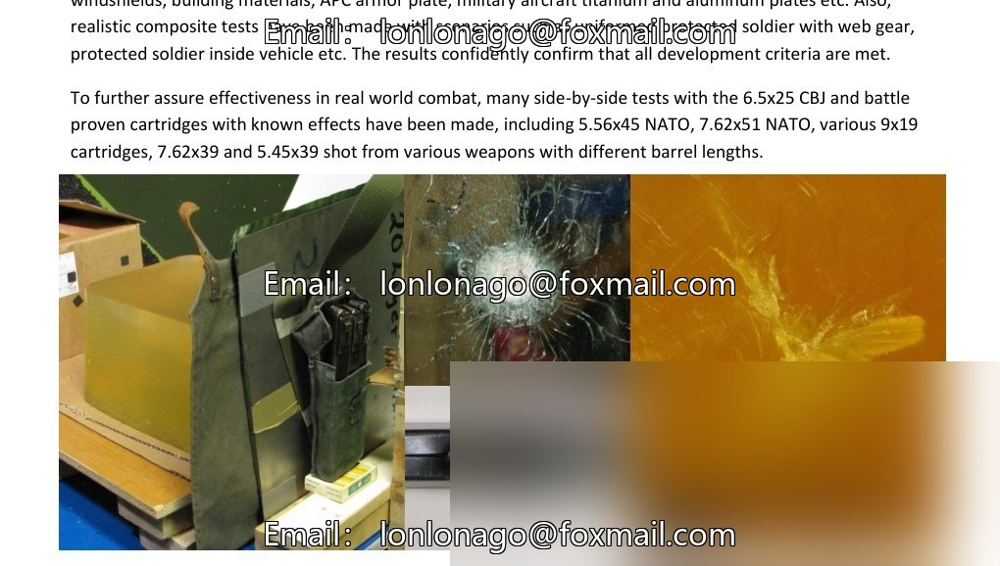

# 6-5x25-Presentation

## Body

6-5x25-Presentation
The content covers performance testing of 6.5x25 CBJ, typical application scenarios, and comparison experiments, and is suitable for military enthusiasts and research on tactical references.
are non-refundable upon sale.

The images show firing direction, target, gelatin block dimensions, impact velocity, ranges and testing scenarios including performance, application and comparison experiments.

<!-- AI_ENRICHED -->

## Images

## Payment

Here is a pay link on Stripe ( https://buy.stripe.com/3cs8yP7sY87d0vu9AB ). Please contact me lonlonago@foxmail.com after funding $89, and I will send you a complete data files , thank you!

